# Foreword

## Who am I

- **Émilien Schultz**
    - Data scientist / research facilitator at CREST
    - *emilien.schultz@ensae.fr*

And you ?

- Discipline (economics, sociology, statistics...)
- What do you use ? (R, Python, Stata, Excel...)
- Have you ever opened a terminal ? Used Git ?

## Why this afternoon ? {.smaller}

Research in economics, sociology and statistics is now **computational**

- Your results depend on code, data and software
- Journals ask for **replication packages** (data editors re-run your code)
- You will work with co-authors, on several computers, sometimes on servers
- In 3 years, someone will ask you how Table 2 was produced
    - *that someone is usually you*

**Digital skills are part of the scientific method, not an IT detail**

## General goals

- Give you the **big picture** : what are these tools, why do they exist
- Understand a few **concepts** that will not change
- **Practice** a little, to break the ice
- Know where to look when you need more
- Discuss what you need in the future

::: {.callout-warning title="What it is not"}
A complete training. You will forget the commands. Keep the concepts.
:::

## Program

1. **The command line** : talking to a computer with text
2. **Git** & **GitHub** keeping track of your work, sharing and collaborating
3. Discussion on **Latex** & **Quarto** (if needed)

## The common thread : your research project

One project (a paper, a thesis chapter) is :

- **data** (survey, administrative data, scraped data, interviews...)
- **code** (cleaning, models, figures)
- **text** (the paper)
- **the compute to run** (software, packages, versions)

Today : how to organize it, keep its history, and share it

# Part 1 - The command line

## Two philosophies organizing interaction with digital devices

- **GUI** = Graphical User Interface
    - mouse + everything visible
    - you can only do what the buttons allow
- **CLI** = Command-Line Interface
    - keyboard (text-based) + everything hidden
    - small tools that can be combined
- Other interfaces, vocal ...


## What is the command line interface ?

> A command-line interface (CLI) is a means of interacting with a computer program by inputting lines of text called command-lines

- In the past, the only way to use a computer
- Today, the common language of
    - servers and computing clusters
    - programming tools (R, Python, Git, Quarto, LaTeX...)
    - and now AI coding assistants

> small, simple programs with clean interfaces can be combined to build larger systems

## Why should a social scientist care ?

- **Reproducibility** : a command can be written down, a click cannot
- **Access** : secure data servers, computing clusters, cloud platforms have no mouse
- **Autonomy** : install tools, understand error messages, follow tutorials on new methods using it
- To impress your friends & family

## Still important for research in the 21st century

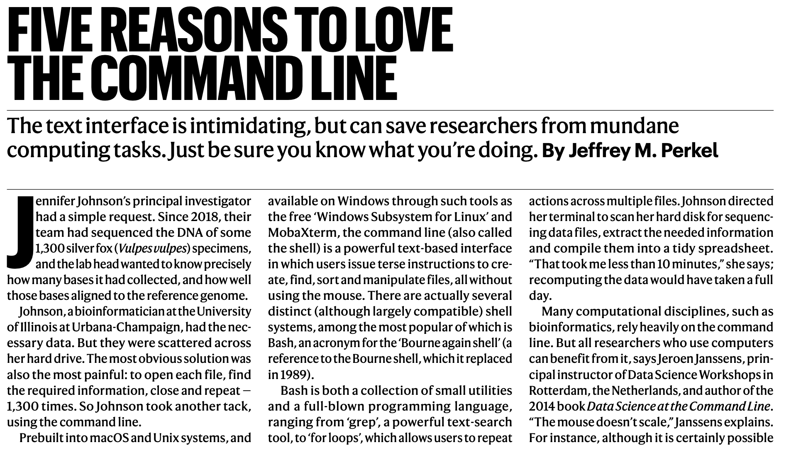{fig-align="center"}

## Especially because Linux is everywhere in research

- All the TOP500 supercomputers run Linux
- So do the servers you will use
    - Onyxia / SSPCloud, lab clusters, Jean Zay (GENCI)
- macOS is a cousin (Unix) ; Windows has WSL
- Free and open : nobody owns it

**Learning the CLI = learning how to talk to all these machines**

## Is it worth it ?

- Remote servers
- Simplify some automation
- Low tech
- Agentic tools use it - at least to understand

## It looks complicated

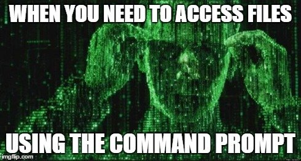{fig-align="center"}

But you only need a small vocabulary, and a few concepts

## You don't have to master all of it

- You will use only a few commands
- You can search / ask an AI assistant
- You can try several times : it is a **dialogue**

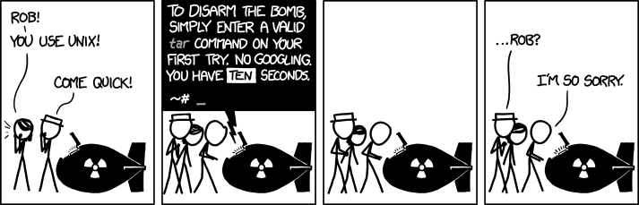{fig-align="center"}

## Before the CLI, the computer {.smaller}

The mouse hides these three dimensions. The command line shows them.

| | What it is | Questions you ask |
|---|---|---|
| 💾 **Storage** | files and directories, on a disk | where is my data ? how big ? Who can access it|
| 🛠️ **Tools** | programs : `ls`, `git`, R, Python, Stata | which one ?which version ? How to install new ones ? |
| ⚙️ **Processes** | programs that are *running*, using CPU and memory | what is running ? is it finished ? |

*A script is stored as a file, executed by a tool, and becomes a process*

(*Yes, we can add transfert/network as another dimension*)

## Concept 1 : the shell

- The **terminal** is the window ; the **shell** is the program that reads your commands
    - Different flavours : Bash[^bash], Zsh (same philosophy)
- A loop : you type a command → it runs → it prints a result → you type again
- Available everywhere
    - Mac / Linux : the Terminal application
    - Windows : [WSL](https://learn.microsoft.com/en-us/windows/wsl/install) or Git Bash
    - Inside RStudio, VS Code, Jupyter

[^bash]: the Bourne Again SHell, derived from a shell written by Stephen Bourne

## Concept 2 : the structure of a command

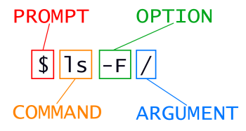{fig-align="center" height="150px"}

- a **name** for a tool (for instance `ls`)
- **options** with flags (`-l` / `--all`) that change the behaviour
- **arguments** : on what it applies (often files)

::: {.callout-note title="Getting help"}
`man ls` (quit with `q`), `ls --help`, or [explainshell.com](https://explainshell.com/)
:::

## Concept 3 : the file system is a tree 🌲 {.smaller}

- Everything is a **file** or a **directory** (folder)
- It starts from a root : `/` (on Windows `C:\`)
- A **path** is the address of a file
   - **Absolute path** : from the root `/home/emilien/thesis/data/survey.csv`
       - changes from one computer to another
   - **Relative path** : from where you are `data/survey.csv`
       - works on your co-author's computer

::: {.callout-important title="A classic replication failure"}
`read.csv("C:/Users/Jean/Desktop/thesis/data.csv")` runs on one computer in the world
:::

---

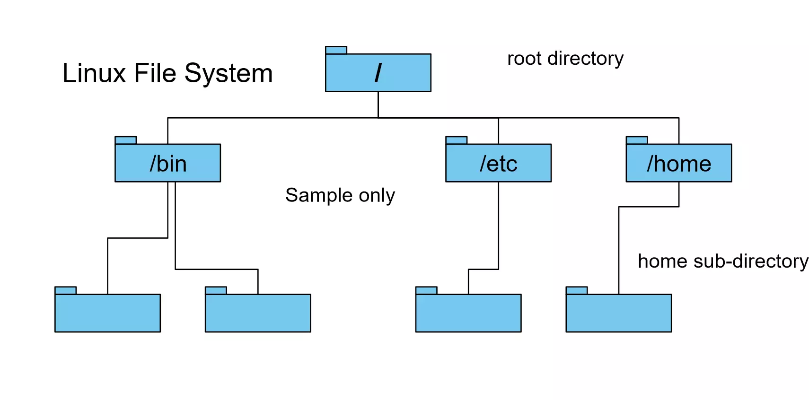{fig-align="center"}

## Concept 4 : you are always somewhere

Every program runs from a **working directory**

- `pwd` : where am I ?
- `ls` : what is here ?
- `cd` : go somewhere else

Shortcuts

- `.` here, `..` the parent folder, `~` your home
- `Tab` to complete names, `↑` for previous commands
- `Ctrl+C` to stop a command, `Ctrl+R` to search your history

## A small vocabulary {.smaller}

| Command | What it does |
|---|---|
| `mkdir` | create a folder (`-p` for nested ones) |
| `touch` | create an empty file |
| `cp` / `mv` | copy / move or rename |
| `rm` | remove (`-r` for a folder) |
| `cat` / `less` | display a file / page through it |
| `head` / `tail` | first / last lines of a file |

::: {.callout-warning title="There is no trash"}
`rm` deletes for good. No undo. Read twice before pressing Enter.
:::

## How to get a terminal

- On your computer
- Or on Onyxia (a terminal in your browser) :
    - INSEE : <https://www.sspcloud.fr/>
    - GENES : <https://onyxia.lab.groupe-genes.fr/>

---

## Let's use it

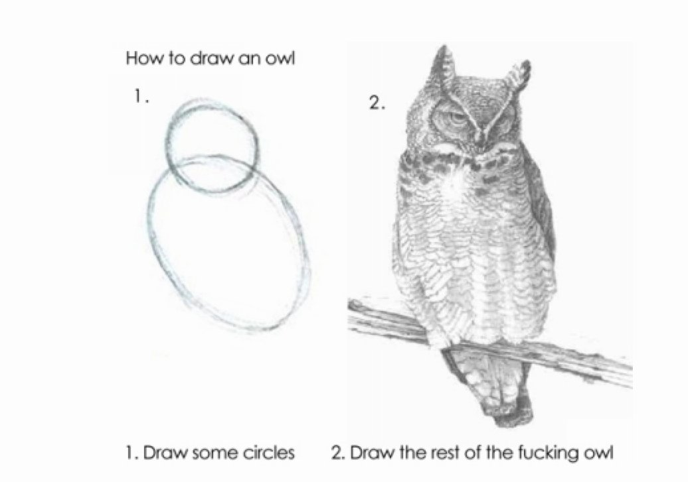{fig-align="center" height="600px"}

## Practice 1 : build a project skeleton {.smaller}

::: {.callout-tip title="Where are you ? What is around ?"}
Find your current directory and list its content, including hidden files and file sizes
:::

::: {.callout-tip}
## Create this structure and go inside
```
phddigitalskills/
├── README.md
├── data
│   ├── processed
│   └── raw
└── scripts
```
:::

::: {.callout-tip title="Check"}
Go to `data/raw`, then come back to `phddigitalskills` using a relative path
:::


## Practice 1 : a solution

``` bash
pwd
ls -lah

mkdir -p phddigitalskills/data/raw phddigitalskills/data/processed
mkdir phddigitalskills/scripts
cd phddigitalskills
touch README.md

cd data/raw
cd ../..
```

::: {.callout-note title="Why this structure ?"}
Raw data is never modified. Everything in `processed` can be rebuilt from `raw` + `scripts`. This is the base of a replication package.
:::

## Concept 5 : small tools, combined

Each tool does one thing ; the **pipe** `|` sends the output of one to the input of the next

``` bash
cat survey.csv | head -n 5
```

And the result can be written to a file

- `>` write (and overwrite)
- `>>` append

``` bash
grep "France" survey.csv > france.csv
```

## Tools to look at data {.smaller}

| Command | What it does |
|---|---|
| `wc -l` | count lines |
| `grep` | keep the lines containing a pattern |
| `cut` | keep some columns |
| `sort` | sort lines |
| `uniq -c` | count repeated lines |
| `curl` / `wget` | download a file |

A 10 Gb file will not open in Excel. `head` takes one millisecond.

## Practice 2 : explore a dataset without opening it {.smaller}

::: {.callout-tip title="Download the Gapminder data in data/raw"}
``` bash
curl -L -o data/raw/gapminder.tsv https://raw.githubusercontent.com/jennybc/gapminder/main/inst/extdata/gapminder.tsv
```
:::

::: {.callout-tip title="Answer with commands only"}
1. What are the columns ? How many rows ?
2. How many rows for each continent ? (`cut -f 2` keeps the second column)
3. Create `data/processed/france.tsv` with only the lines about France (and the header)
:::

## Practice 2 : a solution {.smaller}

``` bash
head -n 3 data/raw/gapminder.tsv
wc -l data/raw/gapminder.tsv

cut -f 2 data/raw/gapminder.tsv | sort | uniq -c

head -n 1 data/raw/gapminder.tsv > data/processed/france.tsv
grep France data/raw/gapminder.tsv >> data/processed/france.tsv
```

::: {.callout-note title="What did we just do ?"}
A data pipeline : raw data → transformation → processed data, with a written trace
:::

## Editing a file in the terminal : vim {.smaller}

On a server there is no window : you edit files in the terminal. `nano` is the simple one (shortcuts are written at the bottom), `vim` is the one installed everywhere.

Vim has **modes** : the keyboard does not do the same thing in each

| Mode | To get there | What the keys do |
|---|---|---|
| **Normal** (at start) | `Esc` | move and give commands |
| **Insert** | `i` | type text, as in any editor |
| **Command** | `:` | save, quit, search |

`vim FILE` to open (or create) → `i` to write → `Esc` → `:wq` to save and quit

- `:w` save, `:q` quit, `:q!` quit **without** saving, `u` undo, `dd` delete a line, `/word` search

::: {.callout-tip title="Lost ?"}
Press `Esc`, then type `:q!`. You will meet vim without asking for it : `git commit` without `-m` opens it.
:::

## From commands to scripts {.smaller}

Put the commands in a file : you get a **script**, the memory of what you did

```bash
#!/bin/bash
# build_france.sh : extract France from the raw data
head -n 1 data/raw/gapminder.tsv > data/processed/france.tsv
grep France data/raw/gapminder.tsv >> data/processed/france.tsv
```

``` bash
bash scripts/build_france.sh
```

The same logic applies to `Rscript clean.R`, `python model.py`, `stata -b do main.do`, `quarto render paper.qmd`

**One command to rebuild everything = a reproducible paper**

## Concept 6 : processes, programs that run {.smaller}

A **process** is a program being executed : it uses CPU and memory (RAM), it starts and it ends. Storage persists, a process does not.

| Command | What it does |
|---|---|
| `top` (or `htop`) | live view of processes, CPU and memory (quit with `q`) |
| `ps aux` | list the processes |
| `Ctrl+C` | stop the process running in your terminal |
| `kill PID` | stop a process by its number |

::: {.callout-note title="In your research"}
*"My laptop freezes when I load the data"* : the file (storage) does not fit in the memory of R (process). *"Is my estimation still running ?"* : `top`
:::

## Concept 7 : environment variables, the context of a process {.smaller}

Each process starts with a set of named values : its **environment**

``` bash
echo $HOME          # your home directory
echo $PATH          # where the shell looks for tools
which python        # which python will actually run ?
export MY_VAR=42    # define a variable (for this session)
```

- `command not found` almost always means : the tool is not in a folder listed in `$PATH`
- Two versions of R or Python on the same computer ? `$PATH` decides
- To make a variable permanent : add the `export` line to `~/.bashrc` or `~/.zshrc`

::: {.callout-tip title="Good practice"}
Passwords and API keys belong in environment variables, not in your scripts : `Sys.getenv("API_KEY")`, `os.environ["API_KEY"]`
:::

## Programs are installed with commands too

- Each system has a package manager
    - Debian/Ubuntu : `apt` ; macOS : `brew` ; Windows : `winget`
- So do languages : `pip` / `uv` (Python), `install.packages()` (R)

``` bash
sudo apt update
sudo apt install pandoc
```

`sudo` = do it as administrator

## sudo

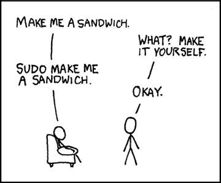{fig-align="center"}

[Credit: xkcd](https://xkcd.com/149/)

## Working on a remote computer {.smaller}

Secure data, big models, long computations : the computer is elsewhere

``` bash
ssh eschultz@server.ensae.fr                 # open a shell on the server
scp results.csv eschultz@server.ensae.fr:~/  # copy a file there
```

- Same commands, another machine
- On a cluster, you do not run, you **submit a job** (`sbatch job.sh`)

[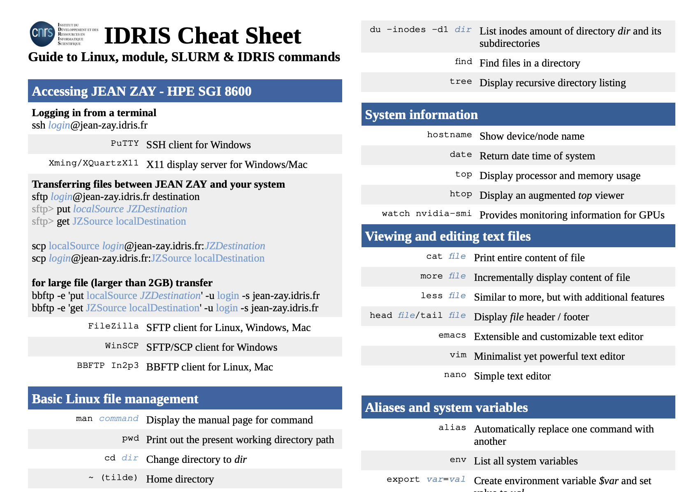{fig-align="center" height="200px"}](../idrischeatsheet.pdf)

## The CLI in the age of AI

- Assistants are very good at writing commands
    - *"how do I count the lines of all csv files in a folder ?"*
- Coding agents now **work in the terminal** and run commands for you

So the skill changes : less writing, more **reading**

- Understand what a command will do before you run it
- Especially with `rm`, `sudo`, and anything touching your data


# Part 2 - Keeping track of your work with Git

## Does this look familiar ?

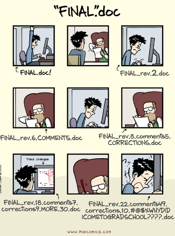{height=600 fig-align="center"}

## The problem

A research project lasts for years, and changes all the time

- Which version of the code produced the figures of the submitted paper ?
- What did I change since the results "worked" ?
- My co-author modified the same file as me
- The referee asks for a robustness check on the 2023 specification

**Version control** : a systematic way to record the history of a project

## Three ways to manage versions {.smaller}

- *Option 1* : copies of the file, sent by email
    - `analysis_v3_final_NC_comments.do`
- *Option 2* : one shared document in the cloud (Dropbox, Overleaf, Google Docs)
    - fine for text, but no clear versions, and code breaks when two people edit it
- *Option 3* : each change is recorded, with an author, a date and an explanation ; everyone has the full history

**Option 3 is Git**

## Where does it come from ?

- Version control tools exist since the 1980s (RCS, CVS, Subversion)
- Git was created in 2005 by Linus Torvalds to develop Linux
    - thousands of contributors, [no central organisation](https://en.wikipedia.org/wiki/The_Cathedral_and_the_Bazaar)
    - the question : how to collaborate efficiently at scale ?
- For sociologists : [Alcaras, *Industrial public goods*, Sociologie du travail, 2020](https://journals.openedition.org/sdt/33283)

Research borrows its tools from the open source community

## Git has a reputation

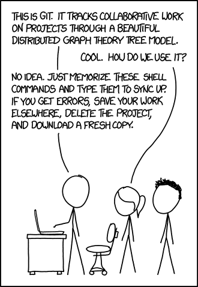{height=600 fig-align="center"}

[Credit: xkcd](https://xkcd.com/1597/)

## What is Git exactly ?

Git is a **command line tool** that

- records snapshots of a folder
- lets you compare, go back, and explore alternatives
- synchronizes copies of the project between computers

It works on any text file : R, Python, Stata, LaTeX, Markdown, Quarto

Also available through buttons : VS Code, RStudio, [GitHub Desktop](https://desktop.github.com/download/)

## Concept 1 : the repository

- A **repository** (repo) = a project folder + its whole history
- The history lives in a hidden `.git` folder
- One project = one repository
    - one paper, one thesis chapter, one package

``` bash
cd phddigitalskills
git init
```

## Concept 2 : the commit

A **commit** is a snapshot of the project at a given time, with

- an author and a date
- a message : *why* this change
- a unique identifier (`a3f9c2e`)
- a link to the previous commit

The history is a chain of commits : the lab notebook of your project

## Concept 3 : you choose what goes in a snapshot

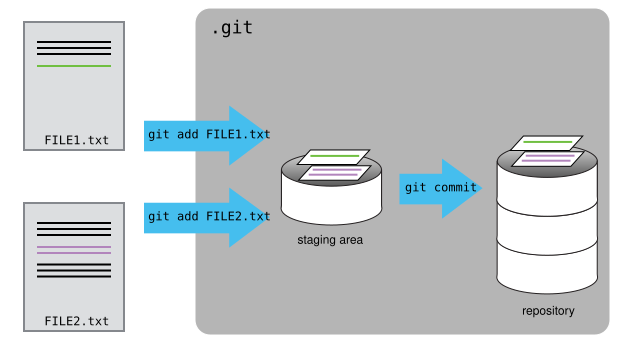{height=450 fig-align="center"}

Working directory → **staging area** (`git add`) → history (`git commit`)

## The basic cycle

``` bash
git status                    # where am I ?
git add scripts/clean.R       # I want this change in the next snapshot
git commit -m "Remove duplicated households before merging"
git log --oneline             # the history
```

Once, on each computer :

``` bash
git config --global user.name "Your Name"
git config --global user.email "your@email"
```

## The message matters

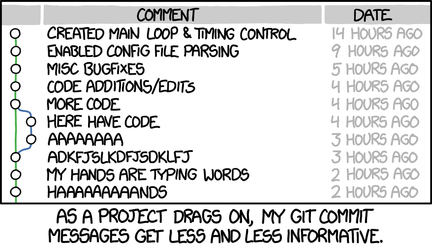{height="450px" fig-align="center"}

[Credit: xkcd](https://xkcd.com/1296/)

Write for your future self : *"Cluster standard errors at the region level"*

## Looking at the past, coming back {.smaller}

- What changed ?
    - `git diff` : since the last commit
    - `git diff a3f9c2e scripts/clean.R` : since a given commit
- Oops
    - `git restore FILE` : discard my current changes on a file
    - `git revert a3f9c2e` : cancel a commit with a new commit
    - `git switch --detach a3f9c2e` : visit the past (`git switch -` to come back)

::: {.callout-warning}
`git restore` and `git reset --hard` throw away uncommitted work. What is committed is (almost) never lost.
:::

## What should not be tracked {.smaller}

Git is made for **code and text**, not for everything

- Data (large, and often **confidential** : survey microdata, CASD, interviews)
- Outputs that can be rebuilt (figures, PDF, logs)
- Passwords, API keys, tokens

List them in a `.gitignore` file

```
data/
*.pdf
.env
.DS_Store
```

::: {.callout-important}
What has been committed stays in the history. Think before the first commit, not after.
:::

## And the data then ? {.smaller}

- Small public data : can live in the repo
- Otherwise : document where it comes from and how to get it (README)
- Archive it properly : [Zenodo](https://zenodo.org/), [data.gouv.fr](https://www.data.gouv.fr/), [Progedo / Quetelet](https://data.progedo.fr/), Harvard Dataverse
- Restricted data : the code is shared, the access procedure is described

**Code in Git, data in a repository made for data**

## And notebooks ? {.smaller}

Jupyter notebooks (`.ipynb`) are widely used... and difficult to version

- A notebook mixes code, text **and outputs** (tables, images) in one big JSON file
- Run it again without changing anything : the file changes
- `git diff` becomes unreadable, conflicts are painful
- Outputs can leak data you are not allowed to share

What to do

- Clear the outputs before committing (or automate it with [nbstripout](https://github.com/kynan/nbstripout))
- Prefer text formats : [Quarto](https://quarto.org/) `.qmd`, R Markdown, or [Jupytext](https://jupytext.readthedocs.io/) to pair a notebook with a `.py` file
- Notebooks to explore, scripts for what goes in the paper

## Practice 3 : your first repository {.smaller}

In the `phddigitalskills` folder

::: {.callout-tip title="Start tracking"}
- Initialize a repository
- Create a `.gitignore` that excludes `data/`
- Write two lines in `README.md`
- Commit (`README.md`, `.gitignore`, `scripts/`)
:::

::: {.callout-tip title="Make history"}
- Modify the README, look at the difference, commit again
- Display the history
- Modify the README again, then change your mind and discard the change
:::


## Practice 3 : a solution {.smaller}

``` bash
git init
echo "data/" > .gitignore
echo "# PhD digital skills" > README.md
git status
git add README.md .gitignore scripts
git commit -m "Start the project"

echo "Gapminder exploration" >> README.md
git diff
git add README.md
git commit -m "Describe the project"
git log --oneline

echo "oops" >> README.md
git restore README.md
```

## Demo : the same thing with buttons (VS Code) {.smaller}

Git is the same underneath, the interface changes

- **Source Control** panel : modified files = `git status`
- Click on a file : side-by-side differences = `git diff`
- `+` next to a file = `git add`
- Message + **Commit** = `git commit`
- Branch name at the bottom left = `git switch`
- **Sync** = `git pull` + `git push`
- Conflicts : *accept current / incoming / both*

Same in RStudio (Git tab) and GitHub Desktop. Use what you like : **the concepts are the same**

## Concept 4 : branches, parallel versions

A **branch** is an independent line of commits

```{mermaid}
%%| fig-align: center
%%| fig-width: 9
gitGraph
   commit id: "clean data"
   commit id: "main model"
   branch robustness
   commit id: "try fixed effects"
   commit id: "add controls"
   checkout main
   commit id: "fix typo"
   merge robustness
   commit id: "submit paper"
```

- Try an idea without breaking what works (`main`)
- If it works : **merge** it. If not : delete it.

## Using branches

And merge one branch to another one !

``` bash
git switch -c robustness     # create a branch and go there
# ... work, add, commit ...
git switch main              # come back : the files change on your disk !
git merge robustness         # bring the work into main
git branch -d robustness     # clean
```

*Branches are cheap, use them : a referee request, a new specification, a risky refactoring*

## And if there are conflicts ? {.smaller}

Two branches changed the same lines : Git asks you to decide

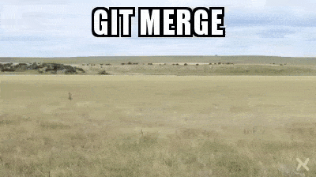{fig-align="center"}

```
<<<<<<< HEAD
model <- lm(y ~ x + age)
=======
model <- lm(y ~ x + age + education)
>>>>>>> robustness
```

- Edit the file to keep what you want, remove the markers
- `git add` the file, then `git commit`

A conflict is not an error : it is a scientific question Git cannot answer for you

## Practice 4 : branch and conflict {.smaller}

::: {.callout-tip title="A parallel version"}
- Create a branch `idea` and switch to it
- Change the **first line** of `README.md`, commit
- Go back to `main` : look at the README. What happened ?
:::

::: {.callout-tip title="Create a conflict (on purpose)"}
- On `main`, change the **same first line** differently, commit
- Merge `idea` into `main`
- Solve the conflict, commit, delete the branch
:::


## Practice 4 : a solution {.smaller}

``` bash
git switch -c idea
# edit the first line of README.md
git commit -am "Rename the project"

git switch main
cat README.md
# edit the first line of README.md differently
git commit -am "Another title"

git merge idea
# CONFLICT : open README.md, choose, remove the markers
git add README.md
git commit -m "Merge idea"
git branch -d idea
git log --oneline --graph
```


# Part 3 - Sharing and collaborating with GitHub

## Git is not GitHub

- **Git** : the tool, on your computer
- **GitHub** : a website that hosts Git repositories + services around them
    - a startup launched in 2008, bought by Microsoft in 2018

:::: {.columns}

::: {.column width="70%"}
- A **remote** copy of your repository
- A system of access rights (private / public, collaborators)
- Tools to discuss the code
:::

::: {.column width="30%"}
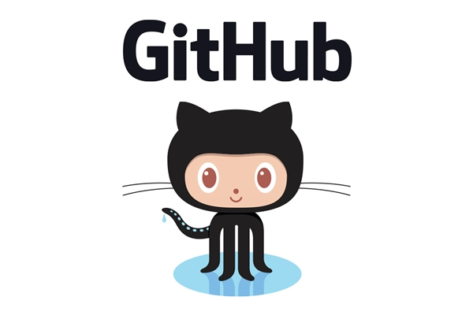
:::
::::

## GitHub is not alone

Platforms hosting Git repositories ("forges")

- [GitLab](https://about.gitlab.com/) : open source, can be self-hosted
    - many institutions have their own instance
- [Codeberg](https://codeberg.org/) : non-profit, community-run
- [Bitbucket](https://bitbucket.org/product/)

Same concepts everywhere. The skills transfer.

## Why use it for research ?

- **Backup** : the history is not only on your laptop
- **Several computers** : laptop, office, server
- **Collaboration** : co-authors, supervisor, research assistants
- **Transparency** : the code of the paper is available, with its history
- **Visibility** : your work can be found, reused, cited

More and more expected : replication packages, data editors, open science policies

## Research relies on shared code

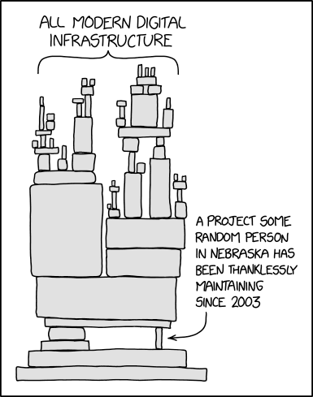{fig-align="center" height="500px"}

[Credit: xkcd](https://xkcd.com/2347/)

## Concept 1 : remote, push, pull

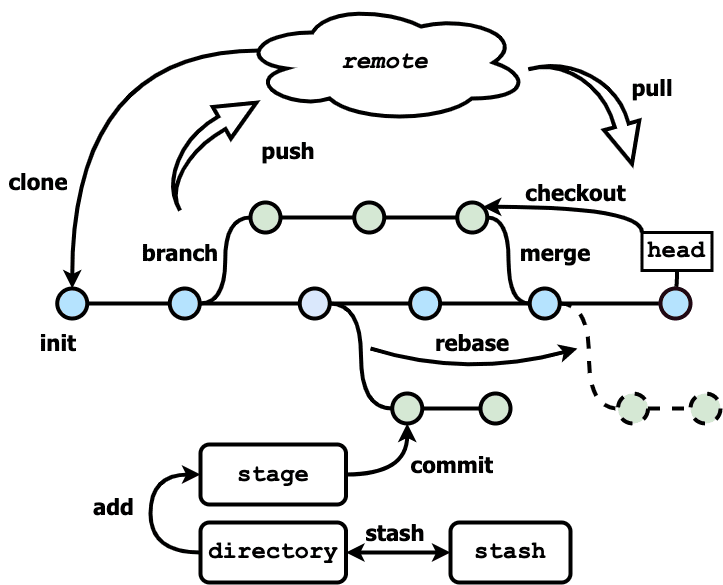{height="450px" fig-align="center"}

- `git clone URL` : get a copy of a remote repository
- `git push` : send my commits ; `git pull` : get the others' commits

## The daily routine

``` bash
git pull                      # start with the latest version
# ... work ...
git add scripts/model.R
git commit -m "Add interaction term"
git push                      # share
```

**Pull before you start, push when you stop**

## Authentication {.smaller}

GitHub needs to know it is you (passwords are not accepted for Git)

- Easiest : [GitHub Desktop](https://desktop.github.com/download/), VS Code, or the [GitHub CLI](https://cli.github.com/) : `gh auth login`
- Classic : an [SSH key](https://docs.github.com/en/authentication/connecting-to-github-with-ssh)
- On a server / Onyxia : a [personal access token](https://docs.github.com/en/authentication/keeping-your-account-and-data-secure/managing-your-personal-access-tokens)

::: {.callout-warning}
A token is a password. Never write it in a file of the repository.
:::

## Concept 2 : issues, the memory of the project

An **issue** = a discussion attached to the repository

- a bug, a question, an idea, a to-do
- *"Referee 2 asks for clustered standard errors"*
- closed when it is solved, and linked to the commits that solved it

For a paper : a shared, searchable to-do list, better than 200 emails

## Concept 3 : the pull request

"I made changes on a branch, could you look before we merge ?"

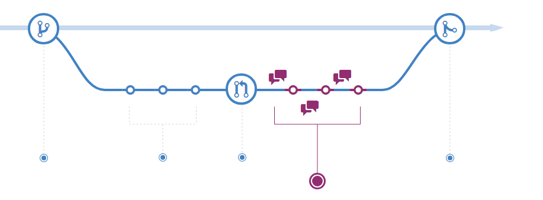{fig-align="center"}

- Your co-author reads the changes, comments, asks for modifications
- **Code review** : the peer review of code, before publication rather than after

## Fork : contributing without permission

A **fork** is your own copy, on GitHub, of someone else's repository

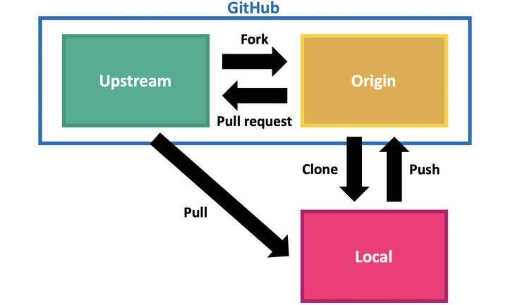{fig-align="center" height="400px"}

This is how you fix a bug in an R package or correct a typo in a course


## Practice 5 : contribute to this course {.smaller}

::: {.callout-tip title="Get in"}
- Create your GitHub account (if needed)
- Open an **issue** with your name on the course repository (= attendance)

<https://github.com/emilienschultz/phddigitalskills>
:::

::: {.callout-tip title="Propose a change"}
- **Fork** the repository
- Edit a file (directly on GitHub with the ✏️ button, or clone it if you are comfortable)
    - fix a typo, add a resource, add your name to `PARTICIPANTS.md`
- Open a **pull request**
:::


## Making your code a research output {.smaller}

A public repository is not yet a publication. Add :

- a **README** : what it is, how to run it, where the data comes from
- a **LICENSE** : what others are allowed to do (MIT, GPL, CC-BY...)
- a `CITATION.cff` file : how to cite it
- the software environment, with versions (next slide)
- an archived **release** with a DOI ([Zenodo](https://zenodo.org/) ↔ GitHub, [Software Heritage](https://www.softwareheritage.org/), HAL)

GitHub can disappear or change ; an archive with a DOI stays

## Software environments {.smaller}

*"It worked on my computer"* : packages change, and the same script can fail, or give other numbers, two years later.

An **environment** = the tools of *one project*, with their exact versions, written in a file

| | Isolate the project | The file to commit |
|---|---|---|
| **R** | `renv::init()` then `renv::snapshot()` | `renv.lock` |
| **Python** | `python -m venv .venv` + `pip`, or `uv` | `requirements.txt`, `uv.lock` |
| **Stata** | `version 18` in the do-file, ado files in the project | the do-file |

- Commit the lock file with Git : code + data + environment = reproducible
- At least, write the versions in the README (`sessionInfo()`, `pip freeze`)
- Going further : containers (Docker), the whole computer in a file

## What a replication package looks like {.smaller}

```
paper-wage-gap/
├── README.md          <- how to reproduce every table and figure
├── LICENSE
├── data/
│   ├── raw/           <- never modified (or instructions to get it)
│   └── processed/
├── scripts/
│   ├── 01_clean.R
│   ├── 02_models.R
│   └── 03_figures.R
├── output/            <- tables and figures, rebuilt by the scripts
└── run_all.sh         <- one command to rebuild everything
```

You already know all the pieces

## More services (for later)

- **GitHub Pages** : a free website (personal page, project documentation)
- **Actions** : run things automatically at each push (tests, rendering a paper)
- **GitHub Education** : free advanced features for students
- **Overleaf** can synchronize a LaTeX project with Git

## Version control in the age of AI

- AI assistants write a lot of code, fast, and sometimes wrong
- Git is the safety net
    - commit before letting an assistant modify your project
    - `git diff` to **read** what it changed
    - a branch for each experiment
- You remain responsible for the code of your paper

## Final overview : where is my work ? {.smaller}

```{=html}
<svg viewBox="0 0 1000 400" style="width:100%;max-height:400px;font-family:sans-serif" xmlns="http://www.w3.org/2000/svg">
  <defs><marker id="ah" markerWidth="10" markerHeight="8" refX="9" refY="4" orient="auto"><path d="M0,0 L10,4 L0,8 z" fill="#333"/></marker></defs>
  <rect x="10" y="40" width="780" height="150" rx="12" fill="#f3f6fb" stroke="#9db3d1"/>
  <text x="25" y="62" font-size="17" fill="#3b5b85" font-weight="bold">Your computer</text>
  <rect x="10" y="245" width="780" height="145" rx="12" fill="#fdf5e6" stroke="#d9b773"/>
  <text x="25" y="380" font-size="17" fill="#8a6418" font-weight="bold">GitHub</text>
  <g font-size="18" text-anchor="middle">
    <rect x="30" y="90" width="200" height="80" rx="8" fill="#fff" stroke="#333" stroke-width="2"/>
    <text x="130" y="122" font-weight="bold">Working directory</text><text x="130" y="148" font-size="15" fill="#555">the files you edit</text>
    <rect x="310" y="90" width="200" height="80" rx="8" fill="#fff" stroke="#333" stroke-width="2"/>
    <text x="410" y="122" font-weight="bold">Staging area</text><text x="410" y="148" font-size="15" fill="#555">the next snapshot</text>
    <rect x="570" y="90" width="200" height="80" rx="8" fill="#fff" stroke="#333" stroke-width="2"/>
    <text x="670" y="122" font-weight="bold">Local repository</text><text x="670" y="148" font-size="15" fill="#555">the history (.git)</text>
    <rect x="570" y="270" width="200" height="80" rx="8" fill="#fff" stroke="#333" stroke-width="2"/>
    <text x="670" y="302" font-weight="bold">Remote repository</text><text x="670" y="328" font-size="15" fill="#555">backup + sharing</text>
    <rect x="110" y="270" width="270" height="80" rx="8" fill="#fff" stroke="#333" stroke-width="2"/>
    <text x="245" y="302" font-weight="bold">Someone else's repository</text><text x="245" y="328" font-size="15" fill="#555">a package, a co-author</text>
  </g>
  <g stroke="#333" stroke-width="2" fill="none" marker-end="url(#ah)">
    <line x1="230" y1="130" x2="308" y2="130"/>
    <line x1="510" y1="130" x2="568" y2="130"/>
    <path d="M670,90 C670,10 130,10 130,88"/>
    <line x1="640" y1="170" x2="640" y2="268"/>
    <line x1="700" y1="270" x2="700" y2="172"/>
    <line x1="570" y1="295" x2="382" y2="295"/>
    <line x1="380" y1="330" x2="568" y2="330"/>
  </g>
  <g font-size="16" font-family="monospace" fill="#6f42c1" text-anchor="middle">
    <text x="269" y="120">git add</text>
    <text x="540" y="84">git commit</text>
    <text x="400" y="24">git restore / git switch</text>
    <text x="628" y="225" text-anchor="end">git push</text>
    <text x="712" y="225" text-anchor="start">git pull / git clone</text>
    <text x="475" y="287">pull request</text>
    <text x="475" y="352">fork</text>
  </g>
</svg>
```

- On your computer : edit → `add` → `commit`, as often as you want
- With the others : `pull` to receive, `push` to send, **pull request** to propose
- `git status` tells you where you are


## Conclusion : for your research

- **Organize** : one project, one folder, a clear structure, relative paths
- **Track** : commit your code and text, explain why
- **Share** : push, collaborate through issues and pull requests
- **Publish** : README, license, archive with a DOI

**Start small : one project, alone, this week. We are here to help.**

## Resources {.smaller}

- [The Unix Shell](https://swcarpentry.github.io/shell-novice/) and [Version control with Git](https://swcarpentry.github.io/git-novice/) - Software Carpentry
- [The Turing Way : Guide for reproducible research](https://book.the-turing-way.org/reproducible-research/)
- [Version control with git (for economists)](https://luispfonseca.com/files/slides_git.pdf)
- [Good practices for statistical projects with R & Git (INSEE)](https://inseefrlab.github.io/formation-bonnes-pratiques-git-R)
- [Happy Git and GitHub for the useR](https://happygitwithr.com/)
- [Pro Git (the reference book)](https://git-scm.com/book/en/v2)
- [Learn Git Branching (interactive)](https://learngitbranching.js.org/)
- Gentzkow & Shapiro, [Code and Data for the Social Sciences: A Practitioner's Guide](https://web.stanford.edu/~gentzkow/research/CodeAndData.pdf)
- Perez-Riverol et al., [Ten Simple Rules for Taking Advantage of Git and GitHub](https://doi.org/10.1371/journal.pcbi.1004947), PLOS Comp. Biol., 2016

## Appendix : commands cheat sheet

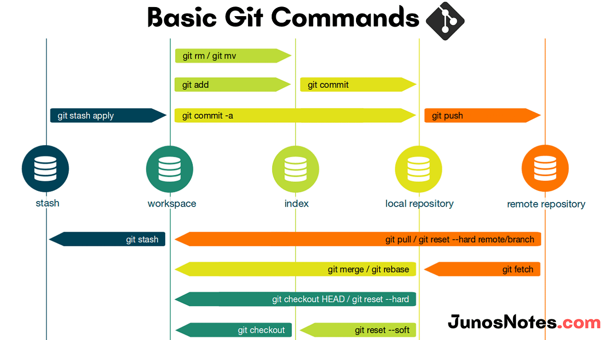{fig-align="center"}
